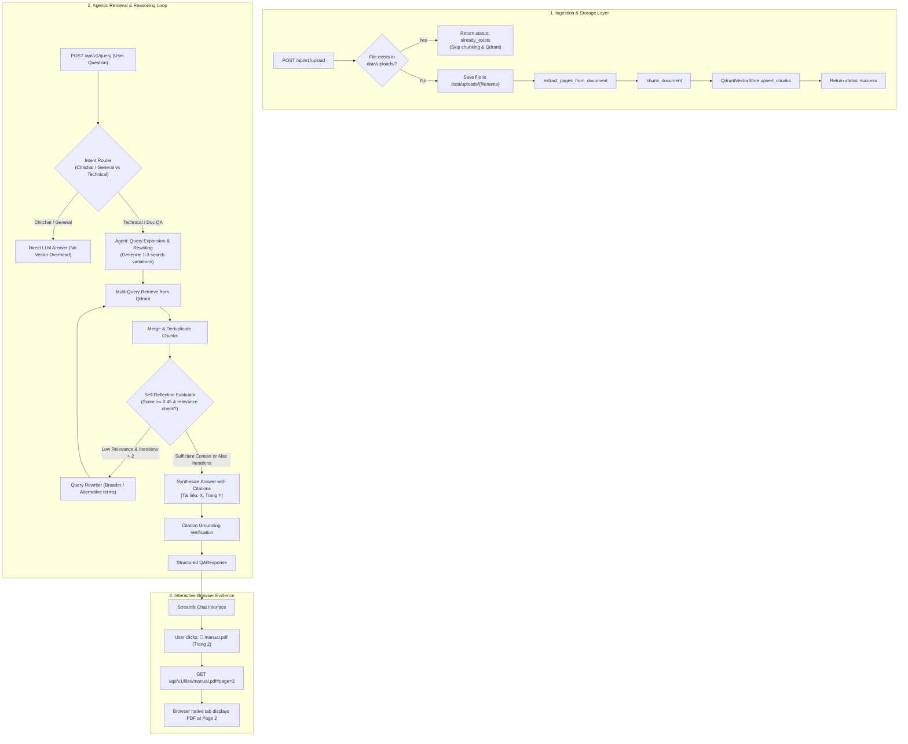

# Design Spec: Agentic RAG with Persistent Storage & Interactive In-Browser Citations

**Author:** Antigravity Team  
**Date:** 2026-10-31  
**Status:** Draft / Pending Review  
**Target Branch:** `feat/agentic-rag-interactive-citations`

---

## 1. Executive Summary & Goals

The Document Q&A Assistant is evolving from a single-pass guardrailed RAG prototype into a **robust, domain-agnostic Agentic RAG system**. The system must handle any user-uploaded documents (PDF, DOCX, TXT, images) across any industry or domain, provide high retrieval accuracy for conversational user questions, preserve all uploaded files permanently while preventing duplicate indexing, and allow users to click directly on citation badges to inspect the exact page in their browser.

### Key Objectives
1. **Persistent Raw File Storage**:
   - Store all uploaded files permanently in `data/uploads/` (git-ignored).
   - Expose a secure file-serving endpoint `GET /api/v1/files/{filename}` supporting inline browser viewing (`FileResponse` with `inline` Content-Disposition, `#page=N` hash navigation for PDFs).
   - Path-traversal protection on all file endpoints.
2. **Deduplication by Filename**:
   - When a file with an already existing name is uploaded, skip duplicate vector extraction and indexing.
   - Return `{ "filename": ..., "status": "already_exists", "message": "File already ingested" }`.
   - Provide `GET /api/v1/files` to inspect all stored documents.
3. **Interactive Clickable Citations (Streamlit UI)**:
   - Convert citation chips into clickable HTML anchor links (`target="_blank"`) pointing to `http://localhost:8000/api/v1/files/{doc_name}#page={page_number}`.
   - Clicking opens the native browser viewer directly at the referenced page.
4. **Agentic RAG Engine (Autonomous Reasoning Loop)**:
   - **Query Expansion & Rewriting**: Convert casual/colloquial user queries into technical search queries and synonyms to bridge the vocabulary gap.
   - **Multi-Query Retrieval**: Retrieve and merge candidate chunks across rewritten queries, removing duplicates.
   - **Iterative Self-Reflection**: Evaluate retrieved chunks. If relevance score or semantic fit is inadequate and iterations < 2, re-formulate the search query.
   - **Grounded Answer Synthesis & Verification**: Retain zero-tolerance hallucination guardrails (only accept citations present in retrieved chunks; abstain if ungrounded).

---

## 2. Architecture & System Flow



---

## 3. Detailed Component Specifications

### 3.1. File Storage & Serving (`src/api/routes.py`, `src/config.py`)
- **Directory**: `data/uploads/` (configured via `settings.upload_dir`, defaults to `"data/uploads"`).
- **Initialization**: Automatically created on application startup (`Path(settings.upload_dir).mkdir(parents=True, exist_ok=True)`).
- **Git Ignore**: Ensure `data/uploads/` is added to `.gitignore`.
- **Deduplication Logic in `/upload`**:
  ```python
  safe_filename = Path(file.filename).name if file.filename else "uploaded_document"
  dest_path = Path(settings.upload_dir) / safe_filename
  if dest_path.exists():
      return UploadResponse(
          filename=safe_filename,
          pages_extracted=0,
          pages_digital=0,
          pages_scanned_ocr=0,
          chunks_indexed=0,
          status="already_exists",
          message=f"Tài liệu '{safe_filename}' đã tồn tại trên hệ thống. Bỏ qua nạp trùng lặp."
      )
  ```
- **File Serving Endpoint**:
  ```python
  @router.get("/files/{filename}")
  async def serve_file(filename: str):
      safe_filename = Path(filename).name
      file_path = Path(settings.upload_dir) / safe_filename
      if not file_path.exists() or not file_path.is_file():
          raise HTTPException(status_code=404, detail="File not found")
      
      mime_type, _ = mimetypes.guess_type(str(file_path))
      mime_type = mime_type or "application/octet-stream"
      return FileResponse(
          path=str(file_path),
          media_type=mime_type,
          headers={"Content-Disposition": f"inline; filename=\"{safe_filename}\""}
      )
  ```
- **List Files Endpoint**:
  ```python
  @router.get("/files", response_model=List[FileSummary])
  async def list_files():
      ...
  ```

### 3.2. Agentic Retrieval & Reasoning Loop (`src/rag/agent.py`)
Create `AgenticRAG` replacing the naive single-pass `RAGGenerator`:

1. **Router & Query Expander**:
   - Analyzes user question and determines if it requires document retrieval.
   - If document retrieval is required: expands original question into 1 to 3 search formulations:
     - Original query.
     - Normalized technical query (key terminology, expanded acronyms).
     - Hypothetical semantic target (HyDE-style keywords).
2. **Multi-Query Retrieval**:
   - Dispatches queries to `retriever.retrieve(q, top_k)`.
   - Merges results using reciprocal rank fusion or score weighting, deduplicating chunks by `(doc_name, page_number, chunk_index)`.
3. **Self-Reflection & Corrective Re-querying (CRAG)**:
   - Evaluates if max score satisfies `min_relevance_score` (default 0.45).
   - If the best score < 0.45 and retry count == 0:
     - Prompts LLM to generalize query or extract broader keywords.
     - Executes secondary search.
4. **Grounded Answer Synthesis & Guardrail Check**:
   - Synthesizes answer citing only valid retrieved chunks: `[Tài liệu: <doc>, Trang <page>]`.
   - Validates that every citation exists in the retrieved chunks; discards hallucinated citations.
   - If no citations are valid or grounded, flags `abstained=True` with `ABSTAIN_PHRASE`.

### 3.3. Interactive Citations in Streamlit UI (`src/ui/components/chat.py`, `src/ui/styles.py`)
- Badges formatted as interactive HTML anchor links:
  ```python
  def format_citation_badge(doc_name: str, page: int, api_base_url: str = "http://localhost:8000") -> str:
      url = f"{api_base_url}/api/v1/files/{doc_name}#page={page}"
      return (
          f'<a href="{url}" target="_blank" class="citation-badge" title="Mở {doc_name} tại trang {page}">'
          f'📄 {doc_name} (Trang {page}) ↗</a>'
      )
  ```
- Styled with hover effects, subtle underline, and accent color `#10a37f` / `#3b82f6` in `styles.py`.
- Browser behavior:
  - PDF: Chrome/Firefox/Safari native viewer opens and jumps to page `page`.
  - PNG/JPG/JPEG: Browser renders image in a new tab.
  - TXT/DOCX: Browser displays or opens file.

---

## 4. Models & API Contracts (`src/models.py`)

```python
class UploadResponse(BaseModel):
    filename: str
    pages_extracted: int
    pages_digital: int
    pages_scanned_ocr: int
    chunks_indexed: int
    status: str = "success"  # "success" | "already_exists" | "error"
    message: Optional[str] = None

class FileSummary(BaseModel):
    filename: str
    size_bytes: int
    uploaded_at: str
    file_type: str

class QAResponse(BaseModel):
    answer: str
    citations: List[Citation]
    abstained: bool
    retrieved_chunks: List[RetrievalResult]
    rewritten_queries: Optional[List[str]] = None
    reasoning_steps: Optional[List[str]] = None
```

---

## 5. Security & Reliability

1. **Path Traversal Defense**:
   All endpoints accessing files on disk must pass through `safe_filename = Path(filename).name`, strictly forbidding `..`, leading slashes, and relative separators.
2. **Safe Concurrent Uploads**:
   File writing is atomic via temporary buffers or standard file locks.
3. **Offline / Mock Resilience**:
   When `LLM_PROVIDER="mock"` or `GEMINI_API_KEY` is unset, `AgenticRAG` falls back to deterministic deterministic expansion and local mock synthesis, keeping test suites 100% offline.

---

## 6. Testing Strategy

1. **Storage & Deduplication Tests (`tests/test_file_storage.py` & `tests/test_api.py`)**:
   - Uploading a new file writes to `data/uploads/` and indexes in Qdrant.
   - Uploading the same file again returns `already_exists` with 0 new chunks.
   - `GET /api/v1/files/{filename}` returns 200 with `inline` disposition.
   - Path traversal attempt (e.g. `../../etc/passwd`) returns 404 or 400.
2. **Agentic RAG Tests (`tests/test_agentic_rag.py`)**:
   - Query expansion produces 1-3 distinct query strings.
   - Multi-query retrieval merges and deduplicates chunks accurately.
   - Low relevance triggers query rewrite step.
   - Citation grounding preserves only true chunks.
3. **UI Component Tests (`tests/test_ui_components.py`)**:
   - `format_citation_badge` generates valid HTML links with `target="_blank"` and `#page=N`.
   - Sidebar renders "Đã có" for already existing files.
4. **Full Regression**: All 59 existing tests pass.

---

## 7. Approval & Next Steps

Upon your review and approval of this specification:
1. We will commit this spec to `docs/superpowers/specs/2026-10-31-agentic-rag-file-persistence-interactive-citations-design.md`.
2. We will invoke `writing-plans` to generate the step-by-step implementation plan.
3. We will execute the plan using Subagent-Driven Development.
