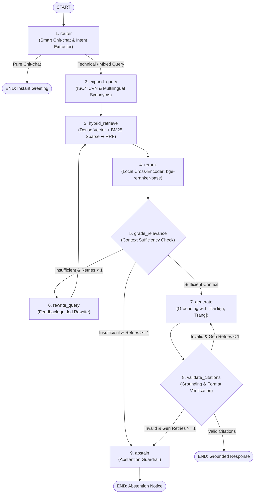

# Architectural Specification: Agentic RAG v2 with Hybrid Search, Local Cross-Encoder, and Closed-Loop LangGraph

- **Date:** 2026-10-31
- **Status:** Approved for Implementation Planning
- **Author:** Antigravity & Engineering Team
- **Target Release:** Agentic RAG v2.0

---

## 1. Executive Summary & Problem Statement

This specification defines the architecture of **Agentic RAG v2**, addressing core limitations identified in technical evaluation:
1. **Heuristic Abstention Flaw:** Relying solely on raw vector similarity threshold (`max_score >= 0.35`) is brittle; high semantic similarity does not guarantee factual answer sufficiency, while uncalibrated thresholds risk false negatives.
2. **Absence of a Reranker:** Merging multi-query dense vector results using unweighted raw cosine scores lacks cross-attention accuracy.
3. **Single Point of Failure in Chit-Chat Router:** Naive regex matching fails on mixed-intent queries (e.g. *"Chào bạn, TCVN 9222 quy định về gì?"*), risking inappropriate canned responses or unintended abstention.
4. **Premature Abstention on Citation Failure:** Formatting anomalies or minor citation hallucinations trigger immediate refusal rather than self-correction.
5. **Acontextual Query Rewrite:** The previous rewrite mechanism lacked awareness of why initial chunks were inadequate, risking repetitive low-quality retrieval.
6. **Lack of Hybrid Search:** Exact standard codes (`TCVN 9222:2012`, `ISO 9906:1999`, `Điều 24`, pump model `TKE-380`) require keyword-exact matching where pure dense embeddings underperform.
7. **Graph Usability & Model Naming:** The visual graph required sequential step numbering, simplified convergence to abstention, and official labeling of `gemini-3.5-flash-lite`.

---

## 2. High-Level Architecture & Workflow

The architecture adopts an 8-node compiled **LangGraph `StateGraph`** with two feedback loops:
1. **Search Sufficiency Loop:** Grader evaluates if retrieved evidence is sufficient; if not, triggers feedback-guided query rewrite.
2. **Citation Correction Loop:** Verifies citation grounding; if hallucinated or malformed, requests one targeted regeneration before abstaining.



---

## 3. Data Structures & State Management

### 3.1 LangGraph Execution State (`AgentState`)

```python
class AgentState(TypedDict, total=False):
    """Execution state passed between nodes in the Agentic RAG v2 graph."""
    
    # Input queries
    question: str                         # Raw user query
    clean_question: str                   # Cleaned query after removing greeting prefixes
    is_chitchat: bool                     # True if query is purely social/greeting
    chitchat_reply: Optional[str]         # Canned friendly response for greetings
    
    # Retrieval & Reranking
    queries: List[str]                    # Active queries for this iteration
    all_queries: List[str]                # Cumulative query history
    candidate_chunks: List[RetrievalResult] # Candidates from RRF (top 20)
    reranked_chunks: List[RetrievalResult]  # Top reranked chunks (top 5)
    
    # Grading & Reflection
    is_sufficient: bool                   # True if chunks contain sufficient factual answers
    grader_feedback: str                  # Explanation of missing information if insufficient
    retries: int                          # Retrieval rewrite attempt counter (max 1)
    
    # Generation & Self-Correction
    gen_retries: int                      # Citation correction attempt counter (max 1)
    citation_feedback: Optional[str]      # Error description passed back to generator
    answer: str                           # Synthesized text
    citations: List[Citation]             # Validated citations
    abstained: bool                       # True if refusing to answer
    
    # Observability
    reasoning_steps: List[str]            # Step-by-step audit log for UI inspection
```

---

## 4. Detailed Component Design

### 4.1 Hybrid Retrieval Subsystem (`src/retrieval/`)

#### A. Sparse BM25 Retriever (`src/retrieval/bm25.py`)
- **Package:** `rank-bm25>=0.2.2`.
- **Tokenization:** Custom Vietnamese- and symbol-aware regex tokenizer `r"[\w]+|[^\s\w]+"` that preserves standard codes (`TCVN`, `9222:2012`, `ISO`, `9906`, `TKE-380`).
- **Index Lifecycle:** Built in-memory upon startup from all stored chunks and dynamically updated upon document upload.

#### B. Dense Vector Retriever (`src/retrieval/local.py`)
- Retains existing Qdrant Cloud / Local storage with `all-MiniLM-L6-v2` embeddings.

#### C. Reciprocal Rank Fusion (RRF) Merger (`src/retrieval/hybrid.py`)
- Combines multi-query dense results and sparse BM25 results using reciprocal rank scoring:
  $$\text{RRF\_Score}(d) = \sum_{m \in \{\text{dense}, \text{sparse}\}} \frac{1}{60 + \text{rank}_m(d)}$$
- Merges candidate pool, eliminates duplicates, and returns Top 20 candidate chunks.

### 4.2 Local Cross-Encoder Reranker (`src/retrieval/reranker.py`)
- **Model:** `BAAI/bge-reranker-base` via `sentence_transformers.CrossEncoder`.
- **Inference:** Scores pairs `(clean_question, chunk.text)` in batch.
- **Selection:** Sorts candidates descending by cross-encoder score and passes Top 5 to the LangGraph state.

---

### 4.3 Node Implementations in `AgenticRAG` (`src/rag/agent.py`)

#### Node 1: `1_router` (Chit-Chat & Mixed Query Disambiguation)
- **Regex & Keyword Classifier:**
  - Evaluates greeting patterns.
  - If pure greeting $\rightarrow$ sets `is_chitchat=True`, populates polite intro, terminates at `END`.
  - If mixed query (e.g. *"Xin chào, tiêu chuẩn TCVN 9222 quy định về điều gì?"*):
    - Strips greeting prefix.
    - Sets `clean_question = "tiêu chuẩn TCVN 9222 quy định về điều gì?"`.
    - Routes to `2_expand_query`.
  - **Fail-safe Default:** If query does not match pure chitchat with 100% confidence, routes to `2_expand_query`.

#### Node 2: `2_expand_query`
- Generates 3 domain-aware query variants (ISO/IEC technical equivalents, specific measurement terminology, unaccented Vietnamese for OCR text resilience).

#### Node 3: `3_hybrid_retrieve`
- Executes parallel Dense + BM25 retrieval for all expanded queries and applies RRF merge.

#### Node 4: `4_rerank`
- Evaluates top-20 RRF pool with `CrossEncoderReranker` to isolate top-5 highest relevance chunks.

#### Node 5: `5_grade_relevance` (Context Sufficiency Grader)
- Evaluates the top-5 reranked chunks using an LLM sufficiency prompt:
  - Input: `clean_question` and concatenated text of top-5 chunks.
  - Output: `{"is_sufficient": bool, "missing_aspects": str}`.
- Conditional Edge:
  - If `is_sufficient=True` $\rightarrow$ proceed to `7_generate`.
  - If `is_sufficient=False` and `retries < 1` $\rightarrow$ proceed to `6_rewrite_query`.
  - If `is_sufficient=False` and `retries >= 1` $\rightarrow$ proceed to `9_abstain`.

#### Node 6: `6_rewrite_query` (Feedback-guided Query Rewrite)
- Prompts LLM with structured feedback:
  - Original question.
  - Prior queries attempted.
  - Brief snippet of what was found.
  - Missing aspects identified by `grade_relevance`.
- LLM produces 2 targeted replacement queries, appends them to `all_queries`, increments `retries`, and loops back to `3_hybrid_retrieve`.

#### Node 7: `7_generate`
- Synthesizes grounded answer using Gemini 3.5 Flash Lite (with fallback chain).
- If `citation_feedback` is present, prepends an error remediation directive:
  *"Lưu ý từ lần sinh trước: Bạn đã trích dẫn nguồn không hợp lệ hoặc thiếu số trang: {citation_feedback}. Hãy chỉ sử dụng thông tin và số trang có trong các đoạn trích dẫn được cung cấp."*

#### Node 8: `8_validate_citations` (Citation Self-Correction Guardrail)
- Validates that citations match retrieved chunks and contain valid page numbers.
- Conditional Edge:
  - If valid $\rightarrow$ terminate at `END`.
  - If invalid and `gen_retries < 1`:
    - Populates `citation_feedback` with specifics of invalid citations.
    - Increments `gen_retries`.
    - Loops back to `7_generate`.
  - If invalid and `gen_retries >= 1` $\rightarrow$ routes to `9_abstain`.

#### Node 9: `9_abstain`
- Emits standardized abstention response: *"Tôi không tìm thấy thông tin này trong tài liệu được cung cấp."* with `abstained=True` and clear audit trail.

---

## 5. Configuration & Dependencies

### 5.1 Updated `pyproject.toml`
```toml
dependencies = [
    # Existing
    "fastapi>=0.110.0",
    "uvicorn>=0.28.0",
    "qdrant-client>=1.8.0",
    "sentence-transformers>=2.5.0",
    "google-genai>=0.1.0",
    "openai>=1.20.0",
    "streamlit>=1.32.0",
    "python-docx>=1.1.0",
    "langgraph>=0.2.0",
    # New addition
    "rank-bm25>=0.2.2"
]
```

### 5.2 Settings in `src/config.py`
```python
class Settings(BaseSettings):
    # Existing
    gemini_model: str = "gemini-3.5-flash-lite"
    min_relevance_score: float = 0.35
    
    # New configurations
    reranker_model: str = "BAAI/bge-reranker-base"
    hybrid_rrf_k: int = 60
    hybrid_candidate_top_k: int = 20
    rerank_top_k: int = 5
```

---

## 6. Backward Compatibility & System Integrity

1. **API Endpoints:**
   - `/api/v1/query` and `AgenticRAG.answer(question, top_k)` preserve identical parameter signatures and return schema (`QAResponse`), ensuring zero breaking changes for the Streamlit UI or API clients.
2. **Offline Testing & Mock Support:**
   - Unit tests use mock CrossEncoder and mock LLM clients to guarantee fast, deterministic pytest execution without internet dependence.

---

## 7. Diagram & Visual Artifacts

- Updated workflow diagram generated via `agent.draw_png("docs/langgraph_workflow.png")`.
- Model label explicitly verified as `gemini-3.5-flash-lite`.
- Step indices strictly synchronized between diagram nodes and audit log messages.
