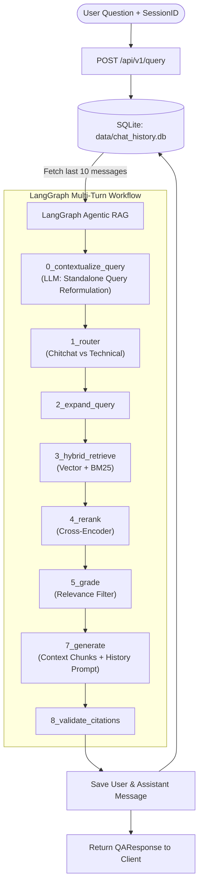

# Multi-Turn Conversation Context Architecture & Design Specification

---

## 1. Executive Summary

This specification defines the architecture, database schema, LangGraph agent enhancement, REST APIs, and frontend integration to introduce **Multi-Turn Conversation Context (Persistent Chat History & History-Aware Query Reformulation)** to the Document Intelligence Assistant.

### Key Objectives:
1. **Database-Persisted Sessions:** Store conversation sessions and message history permanently in SQLite (`data/chat_history.db`) with zero external service dependencies.
2. **History-Aware Query Reformulation (Contextualization):** Automatically resolve co-references, pronouns, and technical follow-ups (e.g. *"Từ kết quả trên hãy tính tiếp cột áp H"*, *"Nó thuộc cấp mấy?"*) into self-contained standalone technical queries using LLM before document retrieval.
3. **Conversational Synthesis:** Provide the last 10 messages (5 user/assistant exchange pairs) as conversation context to the LLM generation prompt to ensure natural, cohesive dialogue.
4. **Interactive Session Management in React SPA:** Display past conversation threads in the Sidebar with instant session switching, new chat creation, and thread deletion.
5. **Zero Breaking Changes:** Preserve backward compatibility for callers that do not supply a `session_id`, maintaining 100% pass rates across existing test suites.

---

## 2. System Architecture & Flow



---

## 3. Data Architecture & Database Schema (`src/storage/session_store.py`)

A dedicated `SessionStore` class manages an isolated SQLite database at `data/chat_history.db`.

### 3.1 SQLite Schema

```sql
CREATE TABLE IF NOT EXISTS sessions (
    id TEXT PRIMARY KEY,
    title TEXT NOT NULL,
    created_at TIMESTAMP DEFAULT CURRENT_TIMESTAMP,
    updated_at TIMESTAMP DEFAULT CURRENT_TIMESTAMP
);

CREATE TABLE IF NOT EXISTS messages (
    id TEXT PRIMARY KEY,
    session_id TEXT NOT NULL,
    role TEXT NOT NULL CHECK(role IN ('user', 'assistant')),
    content TEXT NOT NULL,
    standalone_question TEXT,
    citations_json TEXT,
    reasoning_steps_json TEXT,
    created_at TIMESTAMP DEFAULT CURRENT_TIMESTAMP,
    FOREIGN KEY(session_id) REFERENCES sessions(id) ON DELETE CASCADE
);

CREATE INDEX IF NOT EXISTS idx_messages_session_id ON messages(session_id, created_at);
CREATE INDEX IF NOT EXISTS idx_sessions_updated_at ON sessions(updated_at DESC);
```

### 3.2 Python Service Interface

```python
class SessionStore:
    def __init__(self, db_path: str = "data/chat_history.db"): ...
    def create_session(self, session_id: Optional[str] = None, title: Optional[str] = None) -> str: ...
    def get_session(self, session_id: str) -> Optional[Dict[str, Any]]: ...
    def list_sessions(self, limit: int = 50) -> List[Dict[str, Any]]: ...
    def delete_session(self, session_id: str) -> bool: ...
    def add_message(
        self,
        session_id: str,
        role: str,
        content: str,
        standalone_question: Optional[str] = None,
        citations: Optional[List[Dict[str, Any]]] = None,
        reasoning_steps: Optional[List[str]] = None
    ) -> str: ...
    def get_recent_messages(self, session_id: str, limit: int = 10) -> List[Dict[str, Any]]: ...
```

---

## 4. LangGraph Contextualizer Node & Prompt Engineering

### 4.1 State Enhancement (`AgentState` in `src/rag/agent.py`)

Add the following fields to `AgentState`:
- `history: List[Dict[str, str]]`: The last 10 messages formatted as `[{"role": "user"|"assistant", "content": "..."}]`.
- `standalone_question: str`: The query after contextual reformulation (used for hybrid retrieval, reranking, and citation matching).

### 4.2 Reformulation Logic (`_node_contextualize_query`)

If `history` is non-empty:
1. LLM evaluates `question` alongside `history`.
2. If `question` contains pronouns or relative expressions (e.g. *"nó"*, *"kết quả vừa tính"*, *"trường hợp 2"*, *"bước trên"*), LLM outputs a single standalone technical question preserving all parameters and context.
3. If `question` is already independent, LLM returns it verbatim.
4. If an LLM call fails or times out, fallback immediately to the raw `question` without blocking.

### 4.3 Generation Prompt Enhancement (`src/rag/prompt.py`)

Update `build_rag_prompt` to accept an optional `history: Optional[List[Dict[str, str]]] = None`:

```python
LỊCH SỬ TRAO ĐỔI GẦN ĐÂY:
Người dùng: Tính lưu lượng Q với đường kính D = 0.2 m...
Trợ lý: Lưu lượng Q = 0.052 m3/s [Tài liệu: doc.pdf, Trang 10].
...

DỮ LIỆU TÀI LIỆU CUNG CẤP:
{joined_context}

CÂU HỎI HIỆN TẠI:
{question}
```

---

## 5. REST API Endpoints & Contract Changes

### 5.1 Updated Models (`src/models.py`)

```python
class ChatMessage(BaseModel):
    role: str
    content: str
    citations: Optional[List[Citation]] = None
    created_at: Optional[str] = None

class SessionSummary(BaseModel):
    id: str
    title: str
    created_at: str
    updated_at: str

class SessionListResponse(BaseModel):
    sessions: List[SessionSummary]

class SessionDetailResponse(BaseModel):
    session: SessionSummary
    messages: List[ChatMessage]

class QARequest(BaseModel):
    question: str
    top_k: int = 8
    session_id: Optional[str] = None

class QAResponse(BaseModel):
    answer: str
    citations: List[Citation]
    abstained: bool = False
    retrieved_chunks: List[RetrievalResult] = []
    rewritten_queries: List[str] = []
    reasoning_steps: List[str] = []
    session_id: str
    standalone_question: Optional[str] = None
```

### 5.2 API Routes (`src/api/routes.py`)

- `GET /api/v1/sessions` ➔ Returns list of recent sessions sorted by `updated_at DESC`.
- `GET /api/v1/sessions/{session_id}` ➔ Returns session metadata and full message history.
- `DELETE /api/v1/sessions/{session_id}` ➔ Deletes session and cascading messages from SQLite.
- `POST /api/v1/query` ➔ Processes query, loads history (up to 10 items), executes LangGraph workflow, persists new messages, and returns answer with `session_id`.

---

## 6. Frontend Integration (React SPA & Streamlit)

### 6.1 React SPA (`frontend/`)

1. **State Management (`frontend/src/App.tsx`):**
   - Track `sessionId: string | null` in React state, initialized from `localStorage.getItem('doc_qa_session_id')`.
   - On initial load: If `sessionId` exists, fetch messages via `GET /api/v1/sessions/{id}` to restore conversation; else, render `EmptyHero`.
   - On "New Chat": Reset `sessionId = null`, clear messages, and clear `localStorage`.
   - On sending message: Pass `sessionId` in `askQuestion(question, topK, sessionId)`. Update `sessionId` from response.
2. **Sidebar Session History (`frontend/src/components/layout/Sidebar.tsx`):**
   - Add "Cuộc trò chuyện gần đây" list below "Cuộc trò chuyện mới".
   - Each item shows `title`, timestamp, and a delete button with confirmation dialog.
   - Clicking an item loads that session's messages and sets it as the active conversation.
3. **Context Indicator (`frontend/src/components/chat/ChatMessage.tsx`):**
   - If `standalone_question` differs from user's original query, display a subtle contextual badge:  
     `🔍 Ngữ cảnh suy luận: "<standalone_question>"`

### 6.2 Streamlit Fallback (`src/ui/app.py`)

- Store `session_id` in `st.session_state["session_id"]`.
- Pass `session_id` to `ui_api_client.query_assistant(question, top_k, session_id)`.

---

## 7. Testing & Verification Plan

1. **Storage Unit Tests (`tests/test_session_store.py`):**
   - Verify SQLite table creation, CRUD operations, cascade deletion, and message window limiting.
2. **Contextualizer Unit Tests (`tests/test_contextualizer.py`):**
   - Verify standalone questions pass through unchanged.
   - Verify co-referenced follow-up queries (*"Nó bằng bao nhiêu?"*) are rewritten accurately with parameters from history.
3. **API Integration Tests (`tests/test_api.py`):**
   - Test `GET /api/v1/sessions`, `GET /api/v1/sessions/{id}`, and `DELETE /api/v1/sessions/{id}`.
   - Test multi-turn query continuity where turn 2 resolves turn 1 context.
4. **Frontend Unit Tests (`frontend/` Vitest):**
   - Verify session switching, session listing in Sidebar, and `askQuestion` sending `session_id`.
5. **Regression Assurance:**
   - Verify all 112 pytest backend tests and 71 frontend tests continue to pass 100%.

